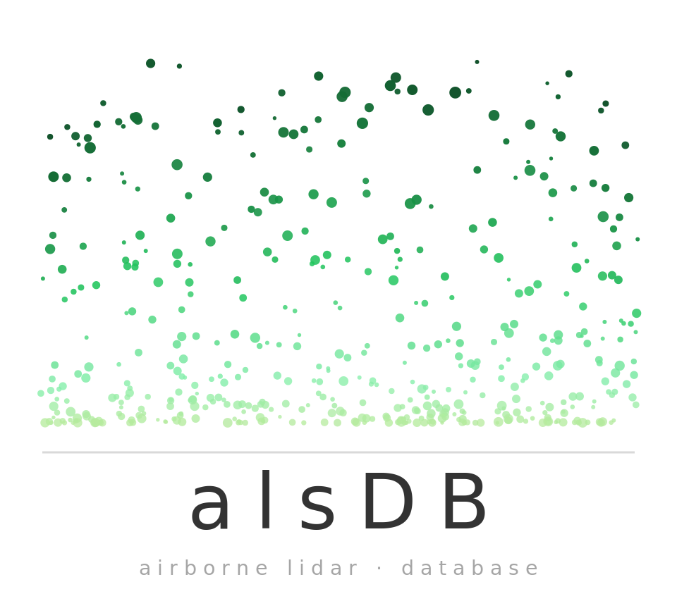

<p align="center">
  <a href="https://github.com/simonbesnard1/alsdb">
    
  </a>
</p>

<h3 align="center">Airborne Laser Scanning point clouds - from LAZ to TileDB at scale</h3>

<p align="center">
  <a href="https://www.python.org/"></a>
  <a href="https://tiledb.com"></a>
  <a href="https://pdal.io"></a>
  <a href="https://opensource.org/licenses/EUPL-1.2"></a>
  <a href="https://github.com/simonbesnard1/alsdb/actions?query=workflow%3ACI"></a>
  <a href="https://codecov.io/gh/simonbesnard1/alsdb"></a>
  <a href="https://github.com/astral-sh/ruff"></a>
  <a href="https://alsdb.readthedocs.io/en/latest/"></a>
  <a href="https://doi.org/10.5281/zenodo.23103178"></a>
</p>

---

**alsDB** reads LAZ/LAS files via [PDAL](https://pdal.io), stores them in a [TileDB](https://tiledb.com) sparse array (locally or on S3-compatible object storage), and provides a full processing pipeline for forest structure and biomass products.

The package is dataset-agnostic — CRS, bounding box, and acquisition year are read directly from the LAZ file header, so any national or global ALS dataset works without custom parsers.

## Features

| | |
|---|---|
| **Scalable ingestion** | Parallel batch ingest; each tile becomes a TileDB fragment |
| **Multi-temporal** | X / Y / Year dimensions; repeated surveys stored and queryable independently |
| **Ingestion manifest** | Tracks CRS, bbox, point count and status; re-ingestion is a no-op by default |
| **CRS-aware schema** | Domain bounds selected automatically from tile CRS or global fallback |
| **Local + S3 storage** | Identical API for filesystem paths and `s3://` URIs (tested on Ceph / RadosGW) |
| **Zarr gridded output** | CHM, DTM, DSM, AGB, gap fraction, LAI, and LiDAR metrics written directly to Zarr v3; no GeoTIFF intermediates, no mosaic step |
| **Tiled processing** | All products support `tile_size` / `n_workers` for large areas; parallel writes go to non-overlapping Zarr chunks |
| **GEDI simulation** | Full-waveform simulation and batch RH metric extraction at GEDI footprint scale |
| **CLI** | `alsdb ingest` and `alsdb info` commands |

---

## Installation

[pixi](https://pixi.sh) is the **only supported install method** — `pdal` and `python-pdal` are conda-only packages and cannot be installed via pip alone.

```bash
git clone https://github.com/simonbesnard1/alsdb.git
cd alsdb
pixi install          # resolves all conda-forge + pip dependencies in one step
pixi shell            # activate the environment
```

> **Note:** `pip install alsdb` will install the pure-Python dependencies but will fail to import without `pdal` present in your environment.

### Dependencies

| Package | Purpose |
|---------|---------|
| `pdal` / `python-pdal` | LAZ/LAS reading, HAG filter |
| `tiledb` | Sparse point-cloud storage (local + S3) |
| `zarr` | Zarr v3 store for gridded products |
| `numpy` / `scipy` | Array operations, rasterisation, peak detection |
| `pandas` / `xarray` | Query result formats |
| `pyarrow` | Parquet I/O for waveform batch results |
| `pyproj` | CRS parsing from WKT |
| `rioxarray` | CRS attachment on `to_dataset()` output (optional) |
| `matplotlib` / `plotly` | Visualisation |
| `click` | CLI |

---

## Quick start

```python
import alsdb
from alsdb import ALSDatabase, ALSProvider

alsdb.setup_logging()

# Ingest
db = ALSDatabase(storage_type="local", uri="my_array")
db.ingest("path/to/tile.laz")  # year, CRS, bbox from LAZ header
db.ingest_many(paths, n_workers=8)  # batch — already-ingested files skipped

# Query
reader = ALSProvider(storage_type="local", uri="my_array")
df = reader.query_bbox(308_000, 4_688_000, 310_000, 4_690_000, year=2021)
print(reader.available_years())  # [2019, 2021, 2023]
```

---

## Examples

Runnable Jupyter notebooks are in the [`examples/`](examples/) folder:

| Notebook | What it covers |
|---|---|
| [`01_ingest.ipynb`](examples/01_ingest.ipynb) | Single tile, batch ingest, manifest, S3 |
| [`02_processing.ipynb`](examples/02_processing.ipynb) | CHM / DTM / DSM, gap / LAI, metrics, biomass (Næsset + sklearn), xarray, change detection |
| [`03_waveform.ipynb`](examples/03_waveform.ipynb) | Single footprint, batch simulation, 3-D waterfall, GEDI comparison |
| [`04_visualisation.ipynb`](examples/04_visualisation.ipynb) | Point cloud plots, waveform plots, gridded product plots |

Full API documentation and a conceptual guide are on [Read the Docs](https://alsdb.readthedocs.io).

---

## CHM methods and uncertainty

See [the CHM guide](doc/chm_methods.md) for native constrained-Delaunay spike-free
processing, terrain support and quality flags, reproducible benchmarks, and
conditional uncertainty ensembles. The native backend is optional:

```bash
pixi run -e spikefree build-spikefree
```

## CLI

```bash
# Ingest a tile
alsdb ingest tile.laz my_array

# Ingest to S3
alsdb ingest tile.laz s3://owner.bucket/als_array \
    --storage-type s3 \
    --s3-url https://s3.example.com \
    --s3-access-key KEY --s3-secret-key SECRET

# Show file metadata
alsdb info tile.laz

# Filter to ground + vegetation classes only
alsdb ingest tile.laz my_array -c 2 -c 3 -c 4 -c 5

# Classify an unclassified survey during ingestion
alsdb ingest tile.laz my_array --classify --ground-method csf --denoise
```

The Python API accepts a validated, reusable classification configuration:

```python
from alsdb import ALSDatabase, ClassificationConfig

classification = ClassificationConfig(
    ground_method="csf",
    denoise=True,
    buffer=30.0,
    vegetation_low=0.5,
    vegetation_medium=2.0,
    vegetation_high=5.0,
)
db.ingest("tile.laz", classification_config=classification)
```

Ground methods: `csf` (default; PDAL, Zhang et al. 2016), `ptd` (progressive
TIN densification, Axelsson 2000: the implementation lasR uses,
[r-lidar/PTD](https://github.com/r-lidar/PTD) by Jean-Romain Roussel (MIT),
vendored in `alsdb/processing/native/ptd` and built with
`pixi run -e spikefree build-spikefree`; settings `ptd_seed_resolution`,
`ptd_angle`, `ptd_distance`, `ptd_spacing`), `smrf` and `pmf` (PDAL). alsdb
runs PTD as a tilt ensemble: once as is and on 7 copies tilted by 10° towards
evenly spaced azimuths, keeping as ground what at least 3 of the 8 runs call
ground (`ptd_tilt_runs`, `ptd_tilt`, `ptd_votes`; `ptd_tilt_runs=1` is a single
run). Classifying rotated copies of the point cloud was Fabian Fischer's
(University of Bristol) suggestion. On held-out steep-terrain tiles the ensemble
cut the DTM error of lasR's default PTD by 17-26%, most at low density, and was
never worse than a single run; it costs 8 PTD runs, which run in parallel
threads (`classification_workers` of `ingest`/`ingest_many`, by default the
available CPUs divided by `n_workers`; `workers` of `alsdb.core.ptd.ptd_ground`)
([doc/benchmarking.md](doc/benchmarking.md#ptd-tilt-ensemble)). On the benchmark's steep and tropical sites PTD gave the lowest DTM and
CHM errors from about 1 pulse/m² up and is recommended; CSF held up best across densities
(best at 0.5 pulses/m² in tropical forest); SMRF was good at full density but
failed below about 2 pulses/m² with PDAL's defaults
([doc/benchmarking.md](doc/benchmarking.md#ground-classification)).

Enabled classification settings and their stable fingerprint are recorded in
the ingestion manifest. Re-ingesting a file with different settings requires
`overwrite=True`.

When `buffer` is positive, `ingest_many()` discovers adjacent files from the
same year and CRS, uses their points as classification context, and writes only
the points owned by each source file. This avoids treating file edges as survey
edges. Single-file `ingest()` cannot supply neighboring context.

Ground classifiers can be compared on deterministic exact-label scenes:

```bash
python -m alsdb.benchmark classification \
    --terrain flat rolling steep rough \
    --density 0.5 2 10 \
    --methods csf pmf smrf \
    --output classification-results.json
```

The benchmark records point-level precision, recall, F1, balanced accuracy,
runtime, and separate boundary/interior F1. Optional Python adapters are also
available for FAST-GC and LAStools `lasground` (and pyLASR, to check alsdb's
PTD against lasR); external tools are
not installed as alsdb dependencies.

To compare classifiers against existing class-2 labels in real LAS/LAZ files:

```bash
python -m alsdb.benchmark classification-files results/classification \
    --laz-dir /data/laz \
    --tools csf pmf smrf ptd fastgc lastools \
    --lastools-dir /opt/LAStools/bin \
    --boundary-width 5
```

Results are appended to `results.csv` (point type I / II errors after Sithole &
Vosselman 2004, and DTM error against the reference terrain) and `strata.csv`
(the same by slope and canopy cover). Successful file/method/parameter runs are
skipped when the command is restarted; failures are recorded and retried. See
[doc/benchmarking.md](doc/benchmarking.md#ground-classification) and its
references for the classifiers (CSF, PMF, SMRF via PDAL; PTD via lasR).

---

## Architecture

```
LAZ file
   │
   ▼
PDAL (readers.las)
   │  year / bbox / CRS ← LAZ header
   ▼
ALSTile.iter_chunks()           ← optional classification filter
   │  X, Y, attrs numpy arrays (1 M pts/chunk)
   ▼
ALSDatabase.write()
   │  TileDB sparse array  (X × Y × Year)
   │  ByteShuffle+ZSTD for float64 X/Y; DoubleDelta+ZSTD for int16 Year
   │  allows_duplicates=True  (multiple returns per XY)
   ▼
TileDB array (local  /  s3://)
   │
   ├── ALSProvider.query_bbox()          → pandas / xarray
   │
   ├── processing.chm / gap / biomass
   │      │  ground TIN normalization + CHM reconstruction
   │      ▼
   │   ALSZarrStore  (Zarr v3, local / s3://)
   │      ├── 1m/   chm, dtm, dsm          (T × ny × nx) float32
   │      └── 10m/  gap, lai, biomass,
   │                h50…density            (T × ny × nx) float32
   │      store.to_dataset(resolution)     → xarray.Dataset (CRS-aware)
   │
   └── processing.waveform               → GEDI-like RH metrics
```

**TileDB schema**

| Dimension | Type | Role |
|-----------|------|------|
| `X` | float64 | UTM easting (m) |
| `Y` | float64 | UTM northing (m) |
| `Year` | int16 | Survey year |

18 LAS attributes (Z, Intensity, ReturnNumber, Classification, RGB, …) are stored as TileDB attributes with ZSTD-9 compression. Spatial tile size defaults to 500 × 500 m; domain bounds are selected automatically per CRS.

Each ingested tile becomes a new TileDB **fragment**. Fragments are consolidated every `consolidate_every` tiles (default 50) to keep read performance healthy as the array grows.

---

## License

EUPL-1.2 — see [LICENSE](LICENSE).

© 2026 Simon Besnard, Helmholtz Centre Potsdam – GFZ German Research Centre for Geosciences.

Forest processing now supports shared CHM/metrics/gap computation, selective and
reusable biomass metrics, batched footprints and streamed tree segmentation.
See [the forest processing guide](doc/forest_processing.md).
